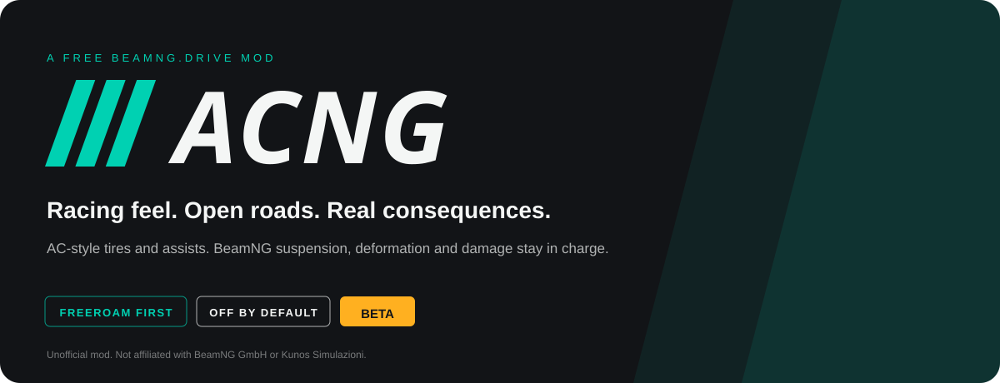
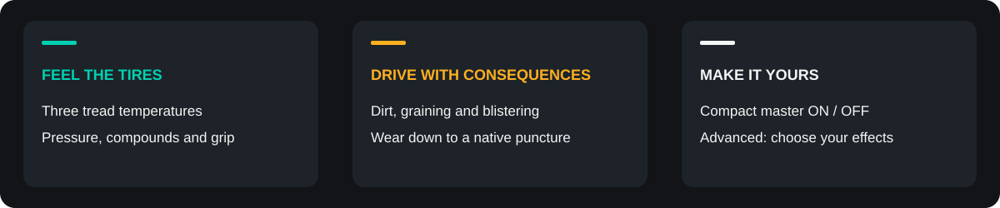
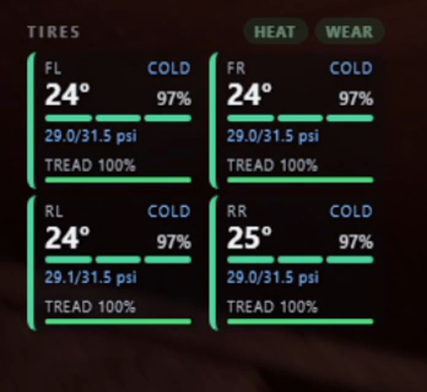
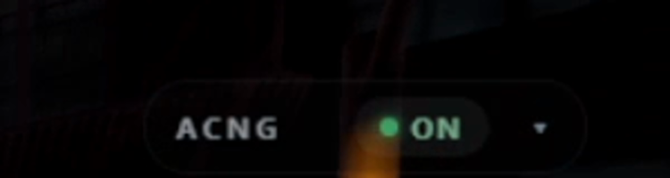
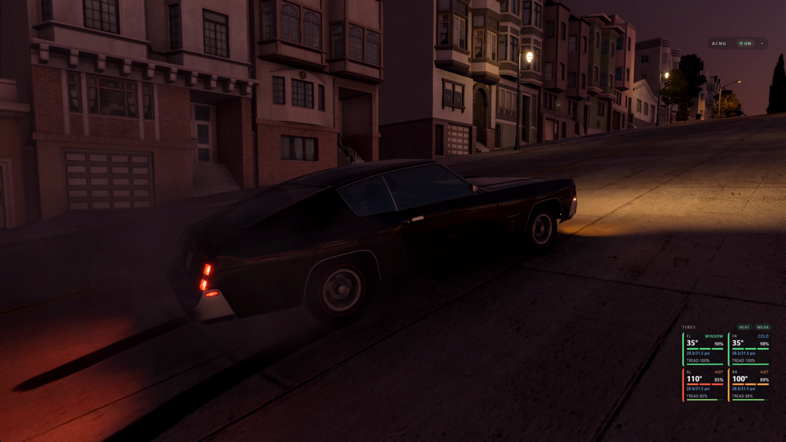

# ACNG

**A freeroam-focused BeamNG mod with tires that warm up, react to pressure, collect dirt and wear down.** One compact switch turns it on; Advanced lets you choose the effects. Keep BeamNG's own suspension, steering, crashes and damage.

[**Download 0.3.1 beta**](https://github.com/AGames21/ACNG/releases/tag/v0.3.1-beta) | [Quick setup](#start-driving) | [Roadmap](docs/ROADMAP.md)

**Scroll down for photos, features and setup. Technical details and test results are near the bottom.**



## What it adds



- **Tires with a working window:** inner, middle and outer temperatures; hot pressure; Road, Sport and Race profiles, or Auto from the fitted vanilla tire.
- **Consequences you can feel:** dirt pickup, cold sliding damage, overheating damage and tread wear. A fully worn tire triggers BeamNG's native puncture.
- **Your setup:** a small ON/OFF app, individual effect switches, configurable assists and optional instruments. Keep factory assists if you prefer.
- **Freeroam first:** native BeamNG traffic and AI, stock suspension and structural damage. No automatic racing opponents.

ACNG is a playable **beta**. It is AC-inspired, with measured tests behind its features; matching a real car or Assetto Corsa one-to-one is still research.

## In game



*Actual in-game HUD. The 0.3.1 patch raises the app, makes it taller and keeps pressure, wear and damage labels visible. Existing custom layouts may need resizing after the update.*



*One small master switch. Open Advanced to pick what you want.*



*Actual stock-car night burnout. The showcase uses labelled WEAR x10 to demonstrate tread loss and native punctures faster.*

## Start driving

No Python or Git needed. Requires your own BeamNG.drive; tested on **0.39.4**.

1. With BeamNG closed, download `acng-freeroam.zip` from [Releases](https://github.com/AGames21/ACNG/releases/tag/v0.3.1-beta) and put it in the user folder's `mods` directory. The launcher has an **Open user folder** button. Disable older ACNG packages.
2. In **UI Apps**, add **ACNG** and **ACNG Tires**.
3. Spawn a stock car and turn ACNG **ON**. Open **Advanced** for effect switches and tire profiles. Reset the vehicle for fresh tires when comparing setups.

A new game starts with ACNG **OFF**. Choices are remembered; the first ON selects tire heat/wear and keeps factory assists. Optional FFB stays OFF. Disable the mod through BeamNG's mod manager to remove it.

[Freeroam guide](docs/FREEROAM.md) | [Report a bug](https://github.com/AGames21/ACNG/issues/new/choose)

## Next improvements

Road-speed calibration, broader vehicle compatibility and damage testing come first. Racing sessions and deeper track systems are later work. No automatic opponent spawning is planned for freeroam.

[Full roadmap](docs/ROADMAP.md)

---

## Technical details and evidence

**287 Python tests and 10 Node app suites pass locally.** Offline tests and actual game checks are recorded separately.

| Native test | What it verifies |
|---|---|
| T009b - 28/28 | Tread zones, pressure window, grain/blister, reset, flat tire and master-OFF restoration |
| T009c - 19/19 | Dirt pickup and cleaning on tarmac |
| T009d / V002 - 15/15 | Cold-to-hot circle, loaded tire heating and straight-line cooling |
| T009f / V002 - 4/4 | Genuine wear to zero and native pressure loss; showcase uses labelled WEAR x10 |
| FR002b - 110/110 | Six stock models, crashes, punctures, missing wheels, reset and disable behavior |
| P001b / P001c | Optional timed refuel and intact-tire tread service; damage and punctures remain |

Native tests run in isolated profiles. These checks establish specific behaviors, not complete real-world tire calibration or AC-equivalent handling. The tire model's recorded T009b update cost is 0.008 ms. Pressure follows both thermal state and BeamNG's native rolling/deformation effects.

[Tire evidence](docs/test-results/t009b-tirephys.json) | [Test guide](docs/TESTING.md) | [HUD release verification](docs/test-results/R006-hud-patch-release.md) | [Architecture](docs/ARCHITECTURE.md)

<details>
<summary><strong>Other modules and current limits</strong></summary>

- ABS/TC: factory, off or three intervention levels. Cars without factory TC use throttle-cut intervention.
- Driving instruments: gear/speed/RPM, pedals, acceleration and braking timers.
- Optional lap tools: deltas, sectors and saved best-lap references.
- Telemetry: passive BeamNG capture and local AC shared-memory research.
- Legacy optional FFB: virtual-wheel tests exist, but physical-wheel feel remains unverified. It stays OFF; no further FFB work is planned.
- Race Weekend is an unfinished prototype excluded from the player ZIP.
- Optional local car-conversion and pit tools are side workflows. No cars or maps are bundled. See [conversion](docs/AC-CAR-CONVERSION.md) and [pit service](docs/SPA-AND-PITS.md).

</details>

<details>
<summary><strong>Build and contribute</strong></summary>

```sh
git clone https://github.com/AGames21/ACNG.git
cd ACNG
python tools/build_freeroam.py
```

The builder packages committed player files only and writes a SHA256 manifest. Lab harnesses, videos and converted assets are excluded.

```text
beamng-mod/   Independent Lua extensions, UI apps and settings
telemetry/    Capture, normalization and comparison
tests/        Offline contracts and isolated native-game harnesses
scripts/      Deployment, launchers and experiment analysis
tools/        Packaging, recording and publication checks
docs/         Architecture, research, benchmarks and evidence
```

Read [AGENTS.md](AGENTS.md) before contributing. Include the game build, vehicle/configuration, enabled effects, reproduction steps and whether the issue also occurs with master OFF. Remove personal data from log excerpts.

</details>

Unofficial and unaffiliated with BeamNG or Assetto Corsa. Original code is [MIT licensed](LICENSE). No proprietary code, game binaries, cars, maps, textures or sounds are redistributed here. Offline/single-player modding only.
